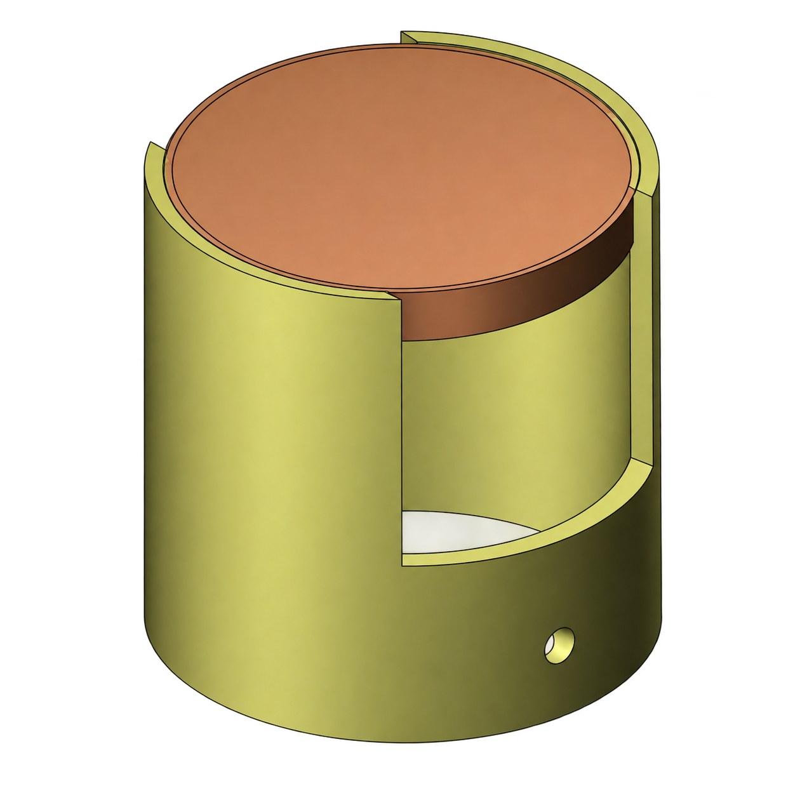

# Rat Head Cap for Electrophysiological Recordings

An aluminum protective head cap for chronically implanted rats. It was used in single-unit recordings from the gustatory cortex of pair-housed rats, where the implant had to survive prolonged contact with a cage-mate (Gerbi, Ben Ami Bartal & Moran, preprint; see [Citation](#citation)). This repository provides the technical drawing and a 3D render so the hardware can be reproduced without contacting the authors.

*Render of the cap base with its screw-on lid. Colors are arbitrary and do not indicate material.*

## Contents

| File | Description |
| --- | --- |
| [`design/head_cap_blueprint.pdf`](design/head_cap_blueprint.pdf) | Workshop drawing of the cap base (front, side and section A-A views), with dimensions, tolerances and thread specification |
| [`design/head_cap_render.png`](design/head_cap_render.png) | 3D render of the assembled cap |
| [`LICENSE`](LICENSE) | Creative Commons Attribution 4.0 International |
| [`CITATION.cff`](CITATION.cff) | Citation metadata |

## Design overview

The cap is a cylindrical aluminum shell with a removable screw-on lid. It is secured to the dental cement (acrylic) surrounding the implanted electrode bundle. It does not hold the electrode itself. Its job is to enclose the implant so that a cage-mate cannot damage it during social sessions and long-term pair housing.

The base includes cut-outs in the wall that provide access for screwing the lead and allow ventilation around the electrode assembly.

### Key dimensions (cap base)

All values are taken from the drawing, in millimeters. The drawing is marked "do not scale"; use the dimensioned values.

| Feature | Value |
| --- | --- |
| Overall height | 30 |
| Outer diameter | Ø29 |
| Connector cut-out | approximately 18 wide × 18 deep (from the top rim) |
| Thread | M27 × 1.0 |
| Cross-hole | Ø2, centered 5 from the bottom edge |
| General tolerance | ±0.1 |
| Surface finish | N7 |

The drawing also specifies the thread-end recess (section A-A), hole and angular tolerances, and edge-breaking rules; please refer to the PDF for these.

## Material and fabrication

The cap used in the experiments was machined from **aluminum** at the Mechanical Workshop of the School of Chemistry, Tel Aviv University.

A note on the drawing: its title block leaves the material field as "not specified", and a Hebrew annotation lists both aluminum (אלומיניום) and Perspex/Plexiglas (פרספקס). The Perspex entry reflects an earlier version of the design. **Use aluminum.** Other Hebrew text on the sheet is workshop production information (notes, production quantity, unit weight).

The M27 × 1.0 thread must be matched between the base and the lid.

## Known limitations

- The drawing covers the cap base only. The screw-on lid shown in the render is not separately dimensioned; it must have a matching M27 × 1.0 thread.
- The design was used and verified in the experiments described in the associated publication. It has not been validated for other species, implant types or recording systems. Check fit against your own implant and connector before use.
- Any use in animal experiments requires approval from your institution's animal care and use committee.

## License

This work is licensed under the [Creative Commons Attribution 4.0 International License (CC BY 4.0)](https://creativecommons.org/licenses/by/4.0/).

You are free to share and adapt these materials for research purposes, provided appropriate credit is given. Institutional names and logos shown on the drawing's title block are not licensed for other uses. The Omnetics connector is a third-party product and is not covered by this license.

## Citation

If you use or adapt this design, please cite both this repository and the associated publication:

> Gerbi R., Ben Ami Bartal I., Moran A. *Social interaction, but not partner state, shapes aversive taste learning and recruits distinct gustatory cortex activity.* Preprint.

<!-- TODO: add DOI / preprint URL once available -->

Repository citation metadata is in [`CITATION.cff`](CITATION.cff).

## Authors and acknowledgements

Ron Gerbi, Moran Laboratory  
Principal investigator: Dr. Anan Moran

Moran Laboratory, Department of Neurobiology, Faculty of Life Sciences, Tel Aviv University, Israel

The engineering drawing was prepared by the Mechanical Workshop, School of Chemistry, Tel Aviv University (Eran R.).

## Disclaimer

The design is provided as is, without warranty of any kind. The authors are not responsible for any damage or harm resulting from its fabrication or use.
